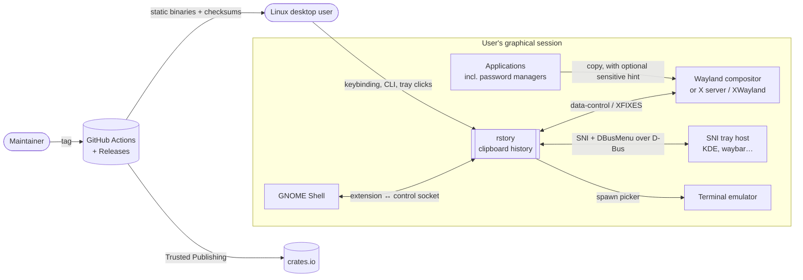
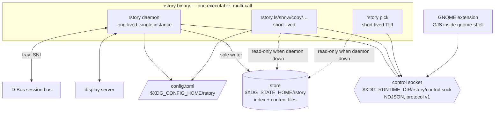

# rstory — architecture

Status: Draft
Last updated: 2026-10-21
Owner stage: `project:architecture` · Mode: **design** (no code yet)
Inputs: `docs/product/brief.md` (Draft, 2026-10-21), spike S1/S2 results
recorded there. No `domain-model.md` yet (it comes from `backend:domain`).

## 1. Summary

rstory is a **local, single-user, single-process system**: one statically
linked Rust binary (`rstory`) that runs either as the long-lived **daemon**
or as a short-lived **client** (CLI, picker). The daemon is the only writer
of the **store** and the only clipboard owner. Every client, including
the tray inside the daemon and the GNOME extension in GNOME Shell, talks
to it through one versioned, newline-delimited JSON protocol over a
per-user Unix **control socket**. Capture uses one of two **backends**:
`wayland` (data-control) or `x11` (XFIXES, also used on Wayland sessions
without data-control through the **XWayland bridge**). There is no server,
no network, no cloud, and no infrastructure cost. "Hosting" is the user's
login session.

## 2. Drivers (ranked, from brief §15)

1. **Portability / zero runtime dependencies.** One static musl binary,
   x86_64 and aarch64, any distro, libc, init or desktop.
2. **Privacy / security.** Hinted secrets never stored, a `0700`/`0600`
   store, 7-day expiry, no network.
3. **Store reliability.** Crash-safe. RPO is at most the in-flight entry,
   and RTO is under 1 s.
4. **Responsiveness.** Capture-to-listed p95 < 100 ms, picker first frame
   p95 < 100 ms.
5. **Frugality.** Event-driven, RSS ≤ 20 MiB, binary ≤ 15 MiB.
6. **Backend extensibility.** A third capture path doesn't touch the store
   or the clients.
7. **Maintainability against GNOME Shell churn.** The extension has no
   logic.

Team: one maintainer with AI agents. Budget: free GitHub and crates.io
tiers only. Residency: the user's machine.

## 3. Inputs used and assumptions

All drivers come from the brief. This document adds the following
assumptions (`[ASSUMPTION]`, also listed in §13):

- AA1. A typical copy is 200 B–4 KiB, with about 500 copies per heavy day
  and bursts of 50 copies/s from scripts.
- AA2. An SSD with fsync latency of 1–10 ms. On spinning disks, capture
  latency is dominated by fsync and may exceed 100 ms p95. That is
  acceptable and documented.
- AA3. MSRV: the stable Rust release from six months before v0.1. CI pins
  an exact toolchain in `rust-toolchain.toml`.
- AA4. GitHub-hosted `ubuntu-24.04` and `ubuntu-24.04-arm` runners are
  available for free to the public repository.

## 4. Capacity model

There is one user per daemon, so "load" means copy rate, client
invocations and store size.

| Quantity | Formula | 1× (defaults) | 10× |
|---|---|---|---|
| Average copy rate | 500 copies/day ÷ 86 400 s | 0.006 /s | 0.06 /s |
| Burst copy rate | script loop (AA1) | 50 /s | 500 /s |
| Capture cost per copy | X11 conversion or Wayland pipe read (~1 ms) + hash (< 0.1 ms for 4 KiB) + content-file write + fsync + index rewrite + fsync (2–20 ms) | ≈ 3–21 ms | same |
| Sustainable capture rate (one writer, two fsyncs/copy) | 1 ÷ capture cost | ≈ 50–300 /s | **at 500/s, bursts exceed it** |
| Client requests | pick ~50/day + tray ~20/day + CLI ~50/day | ~120 /day | ~1 200 /day (negligible) |
| Concurrent clients | Little: ~1 req/s × 5 ms | < 1 | < 1 |
| Index size | entries × ~256 B metadata + 256 B preview | 20 × 512 B ≈ 10 KiB | at configured max 500 → 250 KiB |
| Content size | entries × avg size | 20 × 4 KiB ≈ 80 KiB typical; 20 MiB worst | 500 × 4 KiB ≈ 2 MiB typical; 500 MiB worst |
| Daemon RSS | runtime + index + previews + one in-flight entry (≤ 1 MiB) + D-Bus/tray | ≈ 6–10 MiB | ≈ 8–12 MiB (index grows by 250 KiB) |
| Picker load | read index (≤ 250 KiB), decode, render | < 5 ms | < 10 ms |

**10× breaking point.** At 500 copies/s, two fsyncs per copy saturate the
single writer, so the capture queue grows and capture-to-listed latency
exceeds 100 ms. **Plan:** the capture pipeline is a bounded queue (256).
When more than one capture is pending, the writer **batches**: one index
rewrite and one directory fsync per batch. With batching, about 1 000/s
is sustained at the same disk. If the queue overflows, the oldest pending
captures are dropped and counted (`dropped_burst`), and `status` shows the
counter. With a 20-entry history, a burst of 500 copies keeps only the
last 20 anyway, so dropping intermediate states loses nothing a user
could reach. Metric: `capture_queue_depth` (max) and the `dropped_burst`
counter.

**Sensitivity.** Raising the count cap to 500 multiplies the index by 25,
to about 250 KiB, which is still a single-file rewrite under 1 ms. The
first thing to break with more entries is the full-index rewrite per copy.
At over 5 000 entries (beyond the config maximum) a log-structured index
would be needed (§12 trigger E3).

## 5. To-be architecture

### 5.1 C4 — system context



### 5.2 C4 — containers (runtime processes)



### 5.3 Components (modules inside the single crate)

| Module | Responsibility | May depend on | Must not depend on |
|---|---|---|---|
| `domain` | Entry, EntryId, ShortId, History rules (de-dup, caps, expiry, pins), pause state, filter decisions. Pure, with no I/O. | — | everything else |
| `store` | Persistence of `domain` state: atomic writes, recovery, permissions, read-only open | `domain` | `backend`, `ipc`, UI modules |
| `session` | Session detection and backend selection (BR5b) | `config` | `store`, UI |
| `backend` | `Backend` trait plus the `wayland` and `x11` implementations: watch, read offered types, read text, serve a restore | `domain` (types only) | `store`, `ipc`, UI |
| `daemon` | Event loop: backend events → filters → store. Owns the clipboard for restores. Single instance, timers (expiry, timed pause), counters | `domain`, `store`, `backend`, `session`, `ipc`, `tray`, `config` | `cli`, `picker` |
| `ipc` | Protocol v1 types (serde), framing, client and server halves, peer-credential check | `domain` (types) | `store`, `backend` |
| `tray` | SNI icon and menu (ksni), rendering from daemon state, sending actions through the in-process daemon API | `domain`, `ipc` types | `store`, `backend` |
| `cli` | clap commands, text and `--json` output, exit codes | `ipc` (client), `store` (read-only API only), `config` | `backend`, `daemon` |
| `picker` | ratatui UI: search, preview, actions | `ipc` (client), `store` (read-only API only), `config` | `backend`, `daemon` |
| `launch` | `picker_command` and terminal detection | `config` | — |
| `doctor` | Diagnostics, reusing `session`, `store` permission checks, `ipc` status and extension state | read-only APIs of all of the above | write APIs |
| `install` | `install-autostart`, `install-gnome-extension` (embedded assets) | `config` | `store`, `backend` |
| `config` | `config.toml` load, validate and defaults (caps bounds) | — | — |

Boundary rules are checked by a fitness function (§10 F1).

### 5.4 Key runtime flows

**Capture.** A backend event (Wayland `selection` on the data-control
device, or an X11 `XFixesSelectionNotify`) delivers the offered MIME
types. The daemon then checks, in order:
1. If paused, count `skipped_paused` and stop.
2. If `x-kde-passwordManagerHint` is offered, count `skipped_sensitive`
   and stop **without reading the content**.
3. If no text type is offered, ignore it (images are Next).
4. Read the text, streaming with a 1 MiB + 1 B limit. If it's over the
   limit, count `skipped_oversize`, discard it, and stop.
5. If the copy is our own restore (we are the owner), move that entry to
   the top (BR2) and stop.
6. Hash it with BLAKE3. On a hit, move the existing entry to the top
   (BR1). On a miss, insert, apply the caps (BR7), and persist.
7. Notify subscribers (tray, extension, open pickers).

**Restore.** A client sends `restore {id}`. The daemon loads the content
and becomes the clipboard owner: a `wayland` data-control source, or an
X11 `SetSelectionOwner` on its own window, serving `UTF8_STRING`, `STRING`,
`TEXT`, `TARGETS` and `text/plain;charset=utf-8`. It replies `ok` once
ownership is confirmed. It serves until another owner takes over.

**Daemon down.** `ls`, `show` and the picker open the store read-only (a
shared `flock` on `store.lock`) and render. Writes and restores print
`daemon not running` with a hint and exit 3 (exit codes are defined in
spec 007).

## 6. Deployment view

| Concern | Choice |
|---|---|
| Artifact | `rstory-<version>-<arch>-unknown-linux-musl.tar.gz`, containing the static binary, LICENSE, README and `SHA256SUMS`. Also `cargo install rstory`. |
| Install | Copy to `~/.local/bin` (or anywhere on `PATH`). No root. |
| Start | `rstory install-autostart` writes `~/.config/autostart/rstory.desktop` (`Exec=rstory daemon`). With `--systemd`, it writes `~/.config/systemd/user/rstory.service` instead (`Restart=on-failure`, `RestartSec=1`, `PartOf=graphical-session.target`). |
| GNOME | `rstory install-gnome-extension` writes `~/.local/share/gnome-shell/extensions/rstory@lucasvmigotto.me/` (ESM extension, `shell-version` 48–51 `[ASSUMPTION: UUID format]`). |
| Paths | Socket `$XDG_RUNTIME_DIR/rstory/control.sock` (dir `0700`). Store `$XDG_STATE_HOME/rstory/` (default `~/.local/state/rstory`). Config `$XDG_CONFIG_HOME/rstory/config.toml`. |
| Environments | dev (`cargo run`, nested sessions), CI (headless sway + Xvfb), release (GitHub Actions on tags). No staging: the "production" is each user's machine. |

## 7. Data view

**Store layout** (`$XDG_STATE_HOME/rstory/`, dir `0700`, files `0600`):

```
store.lock            flock: exclusive for the daemon, shared for read-only clients
index.json            versioned index: {version, entries:[{id, hash, size, created, last_copied, pinned, preview}], state:{paused_until|paused, counters}}
content/<id>          raw UTF-8 bytes of one entry, written once, never modified
```

- **Writes:** content goes to `content/.tmp-<id>` → fsync → rename →
  fsync the directory. Then the index goes to `index.json.tmp` → fsync →
  rename → fsync the directory. A crash between the two steps leaves an
  orphan content file, which is removed on startup. The index is the
  source of truth (ADR-0003).
- **Delete** (rm, clear, expiry, cap): remove from the index (atomic
  rewrite), then unlink `content/<id>`. Startup sweeps orphans in both
  directions.
- **Ids:** `id` is a 128-bit random value (ULID-like: time-ordered prefix
  plus random). `short id` is the shortest unique prefix, minimum 4 chars.
  `hash` is BLAKE3 over the content (the `pure` feature, with no C/asm
  build) and is used only for de-duplication.
- **Preview:** the first 256 chars with control characters escaped. It
  lives in the index so `ls` and the picker don't open content files.
- **No content is ever logged.** Counters and ids only.
- **Backups:** N/A (local, ephemeral by design). `$HOME` backups may
  capture the store, which the threat model covers through expiry.
- **Retention:** 7 days unpinned, plus the count and pin caps. The
  housekeeping timer runs at startup, then at the next expiry instant
  (one-shot timer, so no polling).

**Protocol v1** (control socket): newline-delimited JSON. A request looks
like `{"v":1,"id":n,"op":"list"|"show"|"restore"|"pin"|"unpin"|"rm"|"clear"|"pause"|"resume"|"status"|"subscribe",…}`.
A response looks like `{"v":1,"id":n,"ok":true,"result":…}` or
`{"v":1,"id":n,"ok":false,"error":{"code":"…","message":"…"}}`.
`subscribe` streams `{"event":"history_changed"|"pause_changed",…}`. The
full schema is owned by `backend:spec` (spec 005's
`contracts/protocol.md` plus a JSON Schema). Peer check: `SO_PEERCRED`
uid must equal the daemon's uid (ADR-0002).

## 8. Decisions summary

| # | Dimension | Choice | ADR |
|---|---|---|---|
| 1 | Deployment shape | Modular monolith: **one crate, one multi-call binary**, with modules as in §5.3 | [0001](adr/0001-single-crate-multi-call-binary.md) |
| 2 | Hosting | N/A as a server. The user's session, started by XDG autostart or a systemd user unit. | one line: local tool |
| 3 | API style | **NDJSON over a Unix socket, versioned**, for every client including the GNOME extension. No HTTP, no D-Bus API. | [0002](adr/0002-daemon-single-writer-ndjson-socket.md) |
| 4 | Data | **Index file + content files with atomic rename.** No embedded database. | [0003](adr/0003-store-index-plus-content-files.md) |
| 5 | Integration & messaging | In-process async tasks plus the socket's `subscribe` stream. No broker. | one line: single process |
| 6 | Identity & access | Unix uid: socket dir `0700` + `SO_PEERCRED` uid match. No accounts. | 0002 |
| 7 | Multi-tenancy | N/A. One daemon per user and session. | — |
| 8 | Resilience & DR | Crash-safe store, startup recovery sweep, systemd `Restart=on-failure`, X11 reconnect for on-demand XWayland. No replicas or backups (local, ephemeral). | 0003, [0005](adr/0005-backend-selection-xwayland-bridge.md) |
| 9 | Observability | `tracing` to stderr/journal, `RUST_LOG`; `status` counters; `doctor`. No telemetry. | one line: brief BR17 |
| 10 | Delivery | GitHub Actions: CI on PRs, release on tags (native x86_64 and arm64 runners, musl targets), crates.io Trusted Publishing in a protected environment | [0009](adr/0009-release-musl-trusted-publishing.md) |
| 11 | Cost | $0/month (free tiers) | §9 |
| 12a | Async runtime | **tokio, `current_thread`** (plus a blocking pool only for file I/O) | [0004](adr/0004-tokio-current-thread-runtime.md) |
| 12b | Capture backends | **wayland-client (pure-Rust backend) + wayland-protocols (ext data control) + wayland-protocols-wlr; x11rb (pure Rust, xfixes)**. XWayland bridge on Wayland without data-control. | 0005, [0006](adr/0006-pure-rust-protocol-stack.md) |
| 12c | Tray | **ksni** (pure Rust on zbus, tokio) with pixel-data icons | 0006 |
| 12d | Terminal UI and CLI | **ratatui + crossterm, clap (derive)**, `nucleo-matcher` for fuzzy search | [0007](adr/0007-ratatui-picker-clap-cli.md) |
| 12e | GNOME extension | **ESM GJS extension embedded with `include_dir`**, a socket client with no logic | [0008](adr/0008-embedded-gnome-extension-socket-client.md) |
| 12f | Serialization & config | serde + serde_json (protocol, index), toml (config) | one line: obvious default |
| 12g | Hashing & ids | blake3 (`pure` feature), random 128-bit ids | one line: no C build, fast |
| 12h | Testing | std tests, proptest (store invariants), insta (+ ratatui `TestBackend`) snapshots, integration tests against headless sway and Xvfb | qa:strategy |

**Language and version:** Rust edition 2024, MSRV per AA3, a pinned
toolchain, `#![forbid(unsafe_code)]` in our crate (dependencies may use
unsafe; audited through `cargo-deny`/`cargo-audit`). The crate is
GPL-3.0-or-later (confirmed by the owner, 2026-10-21).

## 9. Cost estimate

| Environment | Monthly | Drivers |
|---|---|---|
| Development | $0 | the maintainer's machine |
| CI | $0 | GitHub Actions, free minutes for public repositories (x86_64 + arm64 runners) |
| Release / distribution | $0 | GitHub Releases, crates.io |
| Runtime | $0 | the user's machine: ~10 MiB RAM, < 1 MB disk typical |

Cheapest acceptable alternative: the same. If the repository went private,
CI minutes would count against the free quota (about 2 000 min/month),
which is enough for this project.

## 10. Architecture fitness functions (automated in CI)

| # | Check | How |
|---|---|---|
| F1 | Module boundaries (§5.3) | A test that parses `use crate::…` in each module directory and fails on a forbidden edge (e.g. `cli → backend`, `picker → store::write`) |
| F2 | Static binary, no dynamic deps | `file target/*/release/rstory` shows "static-pie linked" or "statically linked". `ldd` reports "not a dynamic executable". |
| F3 | No native libraries or network crates | `cargo deny check bans`: deny `openssl-sys`, `libdbus-sys`, `wayland-sys` (with the `client_system` feature), `xcb`, `reqwest`, `hyper`, `ureq`, `tokio` `net` TCP use outside Unix sockets (reviewed), `cc`-built crates allow-listed only |
| F4 | Licences GPL-3.0-compatible | `cargo deny check licenses` |
| F5 | Binary size ≤ 15 MiB | CI step on release builds |
| F6 | Picker first frame < 100 ms (20 and 500 entries) | Benchmark with a synthetic store, run in CI as a smoke test with a generous bound and on the release checklist |
| F7 | Capture-to-listed < 100 ms p95 | Integration test on headless sway and Xvfb: 100 copies, measure `ls` visibility |
| F8 | Store invariants (caps, de-dup, expiry, pins, sensitive never persisted) | proptest suites (spec 001, 006) |
| F9 | Permissions | Test: after any operation, dir `0700` and files `0600`. Socket dir `0700`. |
| F10 | Idle quietness | Test: the daemon idles 60 s under headless sway, with the process's wake-ups counted through `/proc/<pid>/schedstat` deltas ≤ a small bound `[ASSUMPTION: bound set in qa:strategy]` |
| F11 | No content in logs | Test: capture a canary string at `RUST_LOG=trace`. The log must not contain it. |

## 11. Risks (architecture-specific)

| Risk | Mitigation |
|---|---|
| wayland-protocols' `ext-data-control-v1` binding or the pure-Rust backend misses a detail (brief S4) | Prototype first in spec 004. The `zwlr` fallback. Patch upstream or vendor the protocol XML through `wayland-scanner` macros. |
| A crate needs a C toolchain at build time (blake3 SIMD, ring, …) | F3 + the `pure` feature + allow-list review. Musl static builds stay reproducible. |
| X11 `INCR` transfers for large selections (> ~256 KiB) on the bridge | Implement INCR in the `x11` backend (both reading and serving). Covered by a 1 MiB integration test. |
| ksni or zbus major-version churn | Pin, wrap behind the `tray` module, a single integration surface |
| GNOME Shell API changes for 49–51 | Minimal extension. Version-gated imports. Manual check on each version before tags (brief R5, Q7). |
| The full-index rewrite per copy | Batching under bursts (§4). Trigger E3. |

## 12. Evolution path

| # | Step | Trigger (metric) |
|---|---|---|
| E1 | Add a `portal` or extension-fed backend (brief feature 023) | `doctor` reports "Wayland, no data-control, no XWayland" in issues from Tier-1 or expected environments, or GNOME announces dropping XWayland |
| E2 | Image support: content files gain a MIME type, keyed by content hash (brief feature 017) | Next phase start (owner decision) |
| E3 | Replace `index.json` with an append-only log plus compaction, or redb | Index rewrite p95 > 20 ms (a `tracing` span histogram), or the config maximum raised above 5 000 entries |
| E4 | Split the crate into a workspace (`rstory-core`, …) | Clean-build CI time > 10 min, or an external consumer asks for the library |
| E5 | Add a D-Bus API next to the socket | A third-party integration needs D-Bus activation or introspection (an issue with ≥ 3 requests) |
| E6 | Encrypted store (brief feature 019) | Later phase. The owner decides. |
| E7 | Batching tuning or a larger queue | `dropped_burst` > 0 reported in normal (non-script) use |

## 13. Open questions & assumptions

- AA1–AA4 (§3).
- `[ASSUMPTION]` GNOME extension UUID `rstory@lucasvmigotto.me`.
- Licence expression `GPL-3.0-or-later`: confirmed 2026-10-21.
- `[ASSUMPTION]` F10's wake-up bound is set in `qa:strategy`.
- Open: brief Q7 (bridge on GNOME 49–51). Q8 is resolved (pins count toward the 20).

## 14. Review against `architecture-quality.md`

- No microservices, Kubernetes, serverless, GraphQL, gRPC, broker,
  cache, polyglot persistence or multicloud. There is one process and one
  store format, each justified by drivers 1 and 3.
- Self-critique: *a 3-person team at 3 a.m.* has nothing to operate (the
  tool runs locally). *First to break at 10×* is the fsync-bound writer,
  handled by batching (§4). *Most expensive to reverse* is protocol v1,
  since the GNOME extension and scripts depend on it, which is why it is
  versioned from day one (ADR-0002). *Halved budget* changes nothing.
- Revision made during review: dropped a separate D-Bus API for the
  extension (decided by the owner) and an embedded database (no access
  pattern needs it at ≤ 500 entries).
