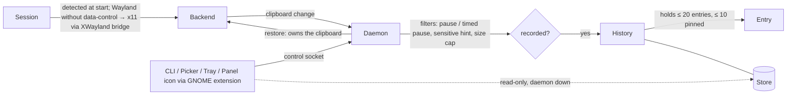

# rstory — product brief

Status: Draft
Last updated: 2026-10-21
Owner stage: `project:init` · Next stage: `project:architecture`

Inline markers: `[ASSUMPTION: …]` is a guess that needs confirming,
`[SPIKE Sn]` is settled by the spike in §17, and `[NEEDS CLARIFICATION: …]`
is open (§18). Every marker is collected in §17 and §18.

---

## 1. Summary

**rstory is a clipboard history for Linux. It ships as one static Rust
binary and works the same on Wayland and X11, under any desktop or
distribution, so a user can get back text they copied earlier without
installing anything else or leaving secrets on disk.**

A background **daemon** watches the **clipboard** and records each text
**entry** in a private **store** on disk. A **CLI**, a built-in terminal
**picker** and a **tray** icon (a **panel icon** from an embedded **GNOME
extension** on GNOME) let the user browse the **history** and **restore** an
old entry to the clipboard. The user then presses paste themselves. The tool
picks its **backend** (Wayland data-control or X11) at start, skips copies
marked sensitive, and expires entries after 7 days. The history is
deliberately small (20 entries by default, up to 10 of them pinned): a
short-term assistant, not a second shell history. It needs nothing at
runtime except the kernel, the session's display server and, for the tray,
the D-Bus session bus. The owner's own session is GNOME on Wayland, which
offers no data-control protocol. There, spike S1 showed that the X11
backend works through the **XWayland bridge**. v0.1 is released only once
rstory works on GNOME.

## 2. Problem & context

**Today.** On Linux the clipboard holds one value. Copying something new
replaces the old value, which is then lost. To get it back, the user has to
find the source again and copy it again.

**Who hurts, and how.**
- Terminal-heavy developers and power users. They copy commands, paths,
  hashes and snippets all day, and they switch sessions (Wayland ↔ X11),
  desktops and distributions.
- Users whose current history tool broke when they switched environments.
  Existing managers are tied to one place: a desktop's own applet, an
  X11-only tool, or a tool that needs `wl-clipboard`, `xclip`/`xsel`, `fzf`,
  GTK or Qt installed.
- Anyone who copies passwords and tokens. Many history tools write them to
  disk in plain text, and offer no pause, no exclusion and no expiry.

**Alternatives users have today.** A desktop-specific applet (works in one
desktop only), X11-only managers (break on Wayland), and Wayland tools built
from `wl-paste --watch`, `cliphist` and `fzf` (several packages, wlroots
only, no GNOME). Each one breaks when the user changes session or distro.

**Why now.** Wayland is now the default session on the major desktops.
`ext-data-control-v1` is standardizing background clipboard access on many
compositors, but not on GNOME. Pure-Rust Wayland, X11, D-Bus and TUI
libraries make a single static binary with no native dependency feasible.

## 3. Goals and non-goals

### Goals (measurable)

| # | Goal | Measured by |
|---|---|---|
| G1 | **One static binary.** No runtime tool or library to install (`wl-clipboard`, `xclip`, `xsel`, `fzf`, `sqlite3`, GTK, Qt, `libwayland`, `libxcb`, `libdbus`, AppIndicator). | `ldd rstory` reports "not a dynamic executable" on the musl builds. A clean Alpine, Debian or Fedora VM works with the binary alone (§14). |
| G2 | **Same behavior on Wayland and X11**, with the backend chosen automatically. | The same CLI test suite passes on every Tier-1 environment (§11). |
| G3 | **Runs on any Linux.** glibc or musl, x86_64 and aarch64, any init system. | Release artifacts for both musl targets. Autostart works without systemd. |
| G4 | **Safe by default.** Sensitive copies are skipped, the store is private, and entries expire. | No copy marked by a sensitive hint ever reaches disk in the test suite. Store mode `0600`, directory `0700`. 7-day expiry. |
| G5 | **CLI parity.** Everything the UI can do, the CLI can do, and its output can be parsed. | Every tray and picker action maps to a CLI command. Listing commands take `--json`. |
| G6 | **Small and quiet.** Event-driven, with no polling loop where an event exists. | Daemon idle CPU ≈ 0 (no timer wake-ups beyond expiry housekeeping). RSS target in §11. |
| G7 | **Works on the owner's GNOME Wayland session.** | v0.1 release gate: capture, restore and the panel icon work on GNOME Shell 48–51. |

### Non-goals

- **Pasting into the focused app.** Input injection needs permissions that
  differ per compositor. rstory restores the clipboard and the user presses
  paste.
- **Sync across machines**, cloud storage or accounts.
- **A full GUI window**, or a GTK or Qt application.
- **macOS, Windows, BSD.**
- **Images, file lists and rich text in the MVP** (images are Next).
- **A native GNOME popup list for the picker in the MVP** (it is Next).
- **Recording the source application** of a copy.
- **Being a password manager or secrets store.**
- **The primary selection (middle-click) in the MVP** (Later, opt-in).
- **Encryption at rest in the MVP** (Later, optional).
- **Translated interfaces.** v1 is English only (decision log, 2026-10-21).
- **A long archive.** The history holds 20 entries by default. Searching
  months of copies is what shell history and notes are for.
- **Installer scripts that need root**, and distribution packages in the MVP.

## 4. Audiences

| Audience | Goals | Context | Frequency | Expertise |
|---|---|---|---|---|
| **Terminal power user** (primary) | Bring back a recent copy with one keybinding. Script against the history. | Tiling compositor (sway, Hyprland, river) or a standard desktop (GNOME, KDE). Lives in a terminal emulator. | Dozens of recalls a day, hundreds of copies a day. | High. Edits dotfiles and binds keys in the compositor config. |
| **Tray user** (secondary) | See the last copies and restore one with the mouse. Pause before copying something private. | GNOME (through the extension), KDE, or a bar with an SNI host (waybar and similar). Rarely opens a terminal. | A few times a day. | Medium. Can run one install command when told to. |
| **Dotfiles / bootstrap maintainer** (operator) | Install one artifact and autostart it the same way on every machine. | Shell scripts and config managers setting up several machines and distros. | At install time and after upgrades. | High. |
| **Maintainer / release publisher** (operator) | Publish releases to crates.io and GitHub without a stored token. | GitHub repository `rstory`, GitHub Actions, crates.io Trusted Publishing. | Per release. | High. |
| **External parties** | — | No server, no accounts, no third party receives data. Password managers and browsers matter only as sources of sensitive hints (§10). | — | — |

## 5. Jobs-to-be-done

**Terminal power user**
- J1. When I copy something and then copy something else, I want to get
  the first one back, so I don't have to find it and copy it again.
- J2. When I switch between Wayland and X11 or between distros, I want the
  same binary, config, history and keybinding to work, so I don't have to
  re-learn or reinstall anything.
- J3. When I script something, I want the history as text or JSON, so I
  can pipe it into other tools.
- J4. When I keep reusing a snippet, I want to pin it, so it never expires
  or gets pushed out of the history.

**Everyone who copies secrets**
- J5. When I copy a password or token from a password manager, I want it
  kept out of the history, so it doesn't linger on disk.
- J6. When I'm about to copy something private that isn't marked
  sensitive, I want to pause recording, so it never gets stored.
- J6b. When I copy from a tool that sets no sensitive hint (such as
  `pass -c`), I want to pause recording for a short time in the same
  command, so I can't forget to resume and can't forget to pause.

**Tray user**
- J7. When I want a recent copy without a terminal, I want to click the
  icon in the top bar and pick from the last 10 entries, so I can restore
  one with the mouse.

**Dotfiles / bootstrap maintainer**
- J8. When I set up a new machine, I want to drop in one binary and run one
  autostart command, so history recording starts at every login whatever
  the distro or init system.
- J9. When something doesn't work, I want one command that says what was
  detected and what is missing in plain words, so I can fix it without
  reading source code.

**Maintainer**
- J10. When I tag a version, I want CI to publish the crate and the static
  binaries with no long-lived token stored anywhere, so a leaked repository
  secret can't publish a malicious release.

## 6. Capabilities & scope

Tags: **MVP** (v0.x, gates v0.1), **Next** (v0.2), **Later**.

### Capture & backends
| Capability | Tag | Reason |
|---|---|---|
| Watch the clipboard and store text (`text/plain;charset=utf-8`; `UTF8_STRING`/`STRING` on X11) | MVP | This is the primary job (J1). |
| Wayland backend through `ext-data-control-v1`, falling back to `zwlr_data_control_manager_v1` | MVP | Covers KDE, wlroots compositors and others (Tier 1). |
| X11 backend through XFIXES selection notifications | MVP | X11 sessions are Tier 1. Also GNOME Wayland's capture path, through the XWayland bridge (S1). |
| Session detection at start (`WAYLAND_DISPLAY`, `DISPLAY`, `XDG_SESSION_TYPE`), overridable in config or by flag | MVP | G2, J2. |
| **XWayland bridge fallback:** on a Wayland session with no data-control protocol but with XWayland (`DISPLAY` set), use the X11 backend through the bridge. This is GNOME's path, and it works on any such compositor. | MVP | G7 release gate. S1 proved it on GNOME Shell 48 (decision log 2026-10-21). |
| Clipboard portal backend, and capture fed by the GNOME extension | Later | Only needed if XWayland is missing (R13). Kept as fallbacks in the backend interface. |
| De-duplication: re-copying identical content moves the existing entry to the top | MVP | Keeps the history useful. Stated in the input. |
| A backend interface that lets a third backend (portal, GNOME-specific) be added without touching the store or the CLI | MVP | S1 may need it. Stated in the input. |
| Primary selection as a second, opt-in history | Later | Different usage pattern, and doubles the privacy surface. |
| Images (`image/png` first), content-addressed files, caps, placeholder or thumbnail in the picker | Next | The first thing after the MVP, per the owner. |
| Rich text / HTML, file lists (`text/uri-list`) | Later | Lower demand. Restoring them correctly needs multiple MIME offers. |
| Recording the source application (where the session reveals it) for a per-app ignore list | Later | Not recorded in the MVP, by owner decision. Sessions expose it unevenly. |

### Daemon
| Capability | Tag | Reason |
|---|---|---|
| `rstory daemon`: records the clipboard, and owns it while serving a restored entry | MVP | Both Wayland and X11 need a live owner for a restored value. |
| One instance per user, enforced through the control socket in `$XDG_RUNTIME_DIR` | MVP | Two recorders would duplicate entries and fight over the clipboard. |
| Pause / resume (nothing is recorded while paused) | MVP | J6. |
| Timed pause: `pause --for <duration>` resumes on its own when the time is up | MVP | J6b. Closes the `pass -c` gap (S2). Decision 2026-10-21. |
| Expiry housekeeping (7 days), count cap (20 entries in all), pin cap (10), size cap (1 MiB) | MVP | G4. Owner decision. |
| Clean restart and store recovery after a crash | MVP | Reliability NFR (§11). |

### CLI
| Capability | Tag | Reason |
|---|---|---|
| `ls`, `show <n>`, `copy <n>`, `pick`, `pin`, `unpin`, `rm`, `clear`, `pause [--for <duration>]`, `resume`, `status`, `config` | MVP | G5, J3, J4, J6b. |
| `--json` on listing commands (`ls`, `show`, `status`) | MVP | J3. |
| Entries addressed by **index** (0 = most recent) or **short id** | MVP | Stated in the input. |
| Reads without a daemon: `ls`, `show` and `pick` (browsing) read the store read-only. Writes (`copy`, `pin`, `unpin`, `rm`, `clear`, `pause`, `resume`) need the daemon and fail with a hint and a non-zero exit. | MVP | Decision 2026-10-21. Restoring needs a live owner anyway. |
| Documented exit codes | MVP | Scripting (J3). `[ASSUMPTION: the code set is defined in project:spec]` |

### Picker
| Capability | Tag | Reason |
|---|---|---|
| `rstory pick`: built-in terminal UI with incremental search, preview and Enter to restore, then exit | MVP | J1 through a keybinding. No `fzf`. |
| Opens quickly enough for a compositor keybinding (first frame < 100 ms) | MVP | §11. |
| Pin, unpin and delete from the picker | MVP | Parity with the CLI. `[ASSUMPTION: the keymap is settled in project:spec]` |
| Image thumbnails or placeholders | Next | Depends on image support. |

### Tray & GNOME
| Capability | Tag | Reason |
|---|---|---|
| StatusNotifierItem tray icon over D-Bus (pure-Rust client, icon sent as pixel data, no icon theme) | MVP | J7. Owner decision. |
| Tray menu: last 10 entries (click restores), pause/resume (icon changes while paused), pause for 1 minute, open picker (hidden when no terminal is found), clear history with a confirm step (pinned entries stay) | MVP | Owner decision. The timed pause item is from the 2026-10-21 decision. |
| `rstory install-gnome-extension`: unpacks the embedded GNOME Shell extension into the user's extensions directory. It provides the panel icon and the same menu, talking to the daemon over the control socket. It carries no capture logic, since capture goes through the XWayland bridge. | MVP | GNOME has no native tray. G7. No AppIndicator requirement. |
| Supported GNOME Shell versions: **48 through 51**. The owner runs 48 (Debian 13), and upstream's current releases are 51 and 50. A new upstream release is added when it ships, and the oldest version is dropped once Debian stable moves past it. Older versions get the CLI and picker without a panel icon. | MVP | Owner decision, 2026-10-21. |
| Native GNOME popup list opened by a keybinding, no terminal | Next | Owner decision. |

### Open picker
| Capability | Tag | Reason |
|---|---|---|
| `picker_command` config. If it isn't set, the default search goes `$TERMINAL` → `xdg-terminal-exec` → `ghostty`, `kitty`, `alacritty`, `foot`, `wezterm`, `ptyxis`, `kgx`, `gnome-terminal`, `konsole`, `xfce4-terminal`, `xterm`. When none is found, the tray entry is hidden and `doctor` lists what was searched. | MVP | The tray's "open picker" needs a terminal (S8). List decided 2026-10-21. |

### Privacy & storage
| Capability | Tag | Reason |
|---|---|---|
| Skip copies offering the `x-kde-passwordManagerHint` MIME type (any value), plus any hint the remaining S2 tests confirm | MVP | J5, G4. S2: the hint survives the XWayland bridge. |
| Size cap of 1 MiB per entry. Oversize copies are dropped (never truncated) and counted. | MVP | Owner decision. |
| Count cap of 20 entries in all (pinned ones included), the oldest unpinned deleted first. Pin cap of 10. Expiry of 7 days, with pinned entries exempt. All defaults are configurable. | MVP | Owner decision 2026-10-21: a small assistant, not a second terminal history. |
| Pause switch and timed pause | MVP | J6, J6b. |
| Store under `$XDG_STATE_HOME/rstory` (dir `0700`, files `0600`), pure Rust, no bundled C database | MVP | G1, G4. |
| Config at `$XDG_CONFIG_HOME/rstory/config.toml` | MVP | Stated in the input. |
| Encrypted store at rest (passphrase or the user's keyring), optional | Later | Owner decision. The MVP relies on a private file, the filter and the short TTL. |
| Export/import of pinned entries (no sync) | Later | Nice to have. |

### Setup & diagnostics
| Capability | Tag | Reason |
|---|---|---|
| `rstory install-autostart`: an XDG autostart `.desktop` entry, or a systemd user unit when systemd user is present and chosen | MVP | J8, G3 (any init). |
| `rstory doctor`: detected session and backend, data-control availability, GNOME path and extension state, store privacy, daemon state, tray host, terminal search, all in plain words | MVP | J9. Journeys 4 and 8. |

### Release & distribution
| Capability | Tag | Reason |
|---|---|---|
| Static binaries for `x86_64-unknown-linux-musl` and `aarch64-unknown-linux-musl` with checksums, attached to GitHub releases | MVP | G1, G3. |
| `cargo install rstory` from crates.io. First publish by hand, every later release through Trusted Publishing from GitHub Actions. | MVP | J10. Owner decision. |
| Distribution packages (AUR, deb, rpm, apk, Nix) | Later | Out of scope for the first releases. |
| Paste injection where a compositor offers a portal for it | Later | Non-goal for now. |
| Interface translations | Later | v1 is English only. |

## 7. Key journeys

**K1 — First run (J8, J9).** The user downloads the binary for their
architecture, puts it on `PATH` and runs `rstory install-autostart`. That
writes `~/.config/autostart/rstory.desktop`, or a systemd user unit when
asked. The user logs out and in, or runs `rstory daemon` once. Then
`rstory doctor` prints, for example, "Wayland session · backend: wayland
(ext-data-control-v1) · store private (0700/0600) · daemon running · tray
host: found".
*Going wrong:* if the store directory already exists with wider
permissions, `doctor` reports it and the daemon refuses to write until it is
fixed `[ASSUMPTION: refuse rather than chmod silently]`. If a daemon is
already running, a second `rstory daemon` exits non-zero with "already
running (pid N)".

**K2 — Recall (J1).** The user copies `git rebase -i HEAD~3` (A), then a URL
(B). Their compositor binds `Super+V` to `rstory pick`, launched in a
terminal through `picker_command`. The list shows B, then A, with relative
times. The user types `reb`, the list narrows to A, and the preview shows
the full text. Enter restores A: the daemon takes ownership of the
clipboard and serves A, and the picker closes. The user presses Ctrl+V in
their terminal. A moves to the top of the history (de-duplication).
*Going wrong:* if the daemon isn't running, the picker still lists entries
(read-only), but Enter shows "daemon not running: start it with `rstory
daemon` or run `rstory install-autostart`" and exits non-zero without
touching the clipboard. If the store is empty, the picker says "No entries
yet".

**K3 — Sensitive copy (J5).** The user copies a password in KeePassXC,
which offers `x-kde-passwordManagerHint` = `secret` alongside the text. The
daemon sees the hint before reading the content, skips the copy, and
increments the "skipped sensitive" counter shown by `rstory status`.
`rstory ls` shows nothing new.
*Going wrong:* a manager that sets no hint is not detected (§17 R2). The
user's protections are pause (K7), the timed pause (K3b), `rstory rm 0`,
and the 7-day expiry. The README says this plainly.

**K3b — Copy from `pass` (J6b).** `pass -c` sets no hint (S2). Following
the README, the user has a shell function
`passc() { rstory pause --for 50s && pass -c "$@"; }`. Running
`passc github` pauses recording, and `pass` copies the password and
restores the previous clipboard 45 s later. Recording resumes by itself at
50 s, so `rstory ls` never shows the password. Meanwhile `rstory status`
and the tray show "paused (resumes in 0:42)".
*Going wrong:* if the daemon isn't running, `rstory pause` exits non-zero,
so `&&` stops `pass` from copying and nothing is exposed to a later daemon.
If the daemon restarts during the pause, the pause continues until its
original end time (BR4).

**K4 — Compositor without data-control (J9).** The user runs a compositor
that offers neither data-control protocol. If XWayland is available, the
daemon uses the XWayland bridge, as on GNOME, and `doctor` reports
"backend: x11 via XWayland bridge (no data-control on this compositor)".
If XWayland is not available, the daemon starts, finds no way to watch the
clipboard, reports that in `status`, and does not pretend to record.
`doctor` then says: "This compositor offers no clipboard-monitoring
protocol (ext-data-control-v1 / zwlr-data-control) and no XWayland. rstory
cannot record in the background here. Options: enable XWayland, or …". The
CLI and picker still show existing history.

**K5 — Switch session (J2).** The user logs into an X11 session instead.
Autostart runs the same binary, which detects X11 and uses XFIXES. The same
config and store are used, so the history recorded on Wayland is there.

**K6 — Scripting (J3).** `rstory ls --json | jq -r '.[] | select(.pinned) |
.id'` lists pinned ids. `rstory show 0 > /tmp/last.txt` writes the latest
entry's raw text with no decoration. `rstory copy ab12` restores the entry
with short id `ab12`.
*Going wrong:* an unknown index or id exits non-zero with "no entry
<ref>". An ambiguous short id lists the candidates and exits non-zero.

**K7 — Tray (J6, J7).** On KDE the user clicks the rstory icon next to the
battery and wifi icons and sees the last 10 entries, each truncated to one
line. A click restores one. Before copying a private note, the user picks
"Pause recording". The icon switches to its paused variant, and `rstory
status` says "paused". They copy the note (not recorded), then pick
"Resume". Later they pick "Clear history…", confirm, and all unpinned
entries are removed from disk.
*Going wrong:* with no SNI host (a bare compositor without a tray), no icon
appears, `doctor` says "no StatusNotifierItem host on the session bus", and
the CLI and picker stay complete. With no terminal found, "Open picker" is
hidden.

**K8 — GNOME setup (G7).** On GNOME Wayland the user runs `rstory
install-gnome-extension`, logs out and in (Wayland requires it), and enables
the extension (`gnome-extensions enable …` or the Extensions app). The
rstory icon appears in the top bar with the same menu as K7. Capture
doesn't depend on the extension: the daemon records through the XWayland
bridge from its first start, even before the extension is installed.
`doctor` reports "GNOME Shell 48 · Wayland, no data-control · backend: x11
via XWayland bridge · extension installed, enabled".
*Going wrong:* if the extension is missing or disabled, `doctor` says
exactly that and gives the command to fix it. Capture, the CLI and the
picker keep working. On a Shell version outside 48–51, the extension
declines to load and `doctor` says so. If XWayland is disabled, capture is
inactive and `doctor` explains (K4, R13).

**K9 — First release (J10).** The maintainer runs `cargo publish
--dry-run`, then publishes v0.1.0 by hand with their personal crates.io
token (kept in their password store, never in the repository). They then
add the repository and the release workflow as a Trusted Publisher in the
crate's crates.io settings and push tag `0.1.1` `[ASSUMPTION: plain SemVer
tags without a "v" prefix, per the owner's git conventions]`. The workflow,
running in a protected GitHub environment with `id-token: write`, exchanges
its OIDC identity for a short-lived crates.io token, publishes, and builds
and attaches both musl binaries and their checksums to the GitHub release.
The token expires with the job. Once that succeeds, the maintainer revokes
the personal token and removes it from their password store.
*Going wrong:* if the dry run or the token's scope fails on the first
publish, nothing is published. The maintainer fixes the token and retries.
If the workflow's OIDC exchange fails, no crate is published, and the
release job fails before uploading binaries `[ASSUMPTION: publish before
attaching binaries, so a release is never half-made]`.

## 8. Domain overview



**Entry lifecycle**

```
 copy seen ──► filtered? ── yes ──► skipped (counted: sensitive | oversize | paused) — never stored
                  │ no
                  ▼
            duplicate? ── yes ──► existing entry moves to top (timestamp refreshed)
                  │ no
                  ▼
              RECORDED ──pin (≤ 10)──► PINNED ──unpin──► RECORDED
                  │                       │
     expiry (7 d) / count cap (20) /     rm
     rm / clear                    │
                  ▼                ▼
               DELETED (removed from disk, not only from view)
```

Pinned entries count toward the 20 but are never evicted by the count cap.
They are exempt from expiry and `clear` `[ASSUMPTION: \`clear --all\` also
removes pinned entries, after a confirm prompt or with \`--yes\`]`. With 10
pins, 10 slots are left for unpinned entries.

**Daemon lifecycle:** starting → (backend detected) recording ⇄ paused
(indefinite, or timed until an end time) → stopping. It can also go starting → *inactive*: running, but with no
capture path (K4), still serving restores where the backend allows and
answering clients.

## 9. Glossary

Every UI string, CLI help text, socket message, config key, code identifier
and doc uses these terms.

| Term | Definition | Not |
|---|---|---|
| **Entry** | One recorded clipboard value (MVP: text) with id, timestamp, content hash, size and pinned flag. Never holds the source application. | item, clip, record, snippet |
| **History** | The ordered, capped set of entries, most recent first. | log, list, archive |
| **Clipboard** | The selection set by Ctrl+C / Ctrl+V (`CLIPBOARD` on X11, the regular selection on Wayland). The only selection recorded in the MVP. | buffer, pasteboard |
| **Primary selection** | The middle-click selection. Not recorded in the MVP (Later, opt-in). | X selection, highlight buffer |
| **Selection** | Umbrella term for the clipboard and the primary selection, used only where both are meant. | — |
| **Capture** | The daemon noticing a clipboard change and deciding whether to record it. | grab, sniff |
| **Restore** | Putting an entry back on the clipboard so the user can paste it. rstory never pastes. | paste, copy back, apply |
| **Backend** | The code that talks to the session's display server: `wayland` or `x11` (a `portal` backend is Later). | driver, provider, adapter |
| **XWayland bridge** | The compositor's mirroring of the Wayland clipboard to XWayland's X11 selections and back. rstory's `x11` backend uses it on Wayland sessions without data-control, such as GNOME. | X11 fallback, compat mode |
| **Session** | The graphical login the daemon runs in, either Wayland or X11. | desktop, display |
| **Data-control** | The Wayland protocols that let a background client watch and set the clipboard: `ext-data-control-v1`, falling back to `zwlr_data_control_manager_v1`. | clipboard protocol |
| **Daemon** | The long-running `rstory daemon` process that captures, holds all state and owns the clipboard while serving a restore. | server, service, agent, background process |
| **Client** | Any thin front end talking to the daemon: CLI, picker, tray, panel icon. | frontend, UI process |
| **Control socket** | The per-user Unix socket in `$XDG_RUNTIME_DIR` that clients use to reach the daemon. | IPC pipe, API |
| **Store** | The private on-disk files under `$XDG_STATE_HOME/rstory` that hold the history. | database, DB, cache |
| **Pinned entry** | An entry kept regardless of expiry, eviction by the count cap, and `clear`. At most 10 by default (pin cap). | favorite, starred, saved |
| **Pause** | The state in which the daemon records nothing. Shown on the tray icon and by `status`. | disable, mute, incognito |
| **Timed pause** | A pause with an end time (`pause --for <duration>`), after which recording resumes on its own. | snooze, temporary disable |
| **Sensitive hint** | A signal offered by the copying application that the content must not be recorded (for example the `x-kde-passwordManagerHint` MIME type). | secret flag, password flag |
| **Size cap** | The 1 MiB per-entry maximum. Larger copies are dropped and counted, never truncated. | limit, max size |
| **Count cap** | The maximum number of entries in the history, pinned ones included (default 20). When it's exceeded, the oldest unpinned entry is deleted. | history length, max entries |
| **Pin cap** | The maximum number of pinned entries (default 10). Pinning past it is refused. | max pins |
| **Expiry** | Deletion of an unpinned entry 7 days after it was last copied. | TTL (allowed only in config and code: `ttl`), retention |
| **Index** | An entry's position in the history, `0` being the most recent. Changes as entries arrive. | number, position |
| **Short id** | A stable short prefix of an entry's id, usable wherever an index is. | hash, key |
| **Picker** | The built-in terminal UI opened by `rstory pick`. | menu, launcher, selector, fzf |
| **Picker command** | The `picker_command` config value used to open the picker in a terminal emulator. | terminal command |
| **Tray** | The StatusNotifierItem icon and menu shown by a tray host (KDE, waybar and similar). | applet, indicator, systray |
| **Tray host** | The bar or shell component that displays StatusNotifierItem icons. | — |
| **GNOME extension** | The small GNOME Shell extension embedded in the binary and installed by `rstory install-gnome-extension`. | plugin, add-on, AppIndicator |
| **Panel icon** | The rstory icon and menu that the GNOME extension draws in GNOME's top bar, which plays the tray's role on GNOME. | tray (on GNOME) |
| **Doctor** | `rstory doctor`, the diagnostic report. | health check, debug |
| **Autostart** | Starting the daemon at login, through an XDG autostart entry or a systemd user unit. | startup, service install |
| **Tier 1** | An environment that must pass before every release (§11). | supported (unqualified) |

## 10. Business rules

| # | Rule | Source |
|---|---|---|
| BR1 | The content hash identifies duplicates. Re-copying identical content moves the existing entry to the top and refreshes its timestamp. It never creates a second entry. | Input §7, §9 |
| BR2 | Restoring an entry makes the daemon the clipboard owner. The resulting clipboard change is not recorded as a new copy, but moves that entry to the top (BR1). | `[ASSUMPTION]` |
| BR3 | While paused, nothing is recorded. Paused copies are counted, not stored. | Input §9 |
| BR4 | Pause survives a daemon restart. An indefinite pause lasts until `resume`. A timed pause lasts until its original end time (or an earlier `resume`). | `[ASSUMPTION: the privacy-safe default; the tray and status make the paused state visible]` |
| BR4b | `pause --for <duration>` sets an end time. When it passes, recording resumes by itself. A new `pause` replaces the end time. `pause --for` exits non-zero when the daemon isn't running. | Decision 2026-10-21 (S2 `pass` gap) |
| BR5 | A copy carrying a sensitive hint is never stored, logged or kept in memory beyond the decision. Hints are checked from the offered MIME types before the content is read. MVP hint: the `x-kde-passwordManagerHint` type is offered (any value). | Input §7, §10; S2 (2026-10-21) |
| BR5b | Backend selection: Wayland with data-control → `wayland`. Wayland without data-control but with XWayland → `x11` through the XWayland bridge. X11 → `x11`. A config or flag override wins. | S1 (2026-10-21) |
| BR6 | A copy larger than 1 MiB is dropped and counted. It is never truncated. | Input §9, owner decision |
| BR7 | At most 20 entries in all, pinned ones included (default). When an insert exceeds that, the oldest unpinned entry is deleted. | Owner decision 2026-10-21 (replaces 500) |
| BR8 | An unpinned entry expires 7 days after its last copy. | Owner decision; "since last copy" `[ASSUMPTION]` |
| BR9 | Pinned entries are exempt from expiry, eviction by the count cap, and `clear`. At most 10 pinned entries (default). Pinning an 11th is refused with a message and a non-zero exit. | Owner decision 2026-10-21 |
| BR10 | Clearing or removing deletes entries from disk, not only from view. | Input §9 |
| BR11 | The source application of a copy is never recorded. | Owner decision |
| BR12 | Entry content is never written to logs, error messages or `doctor` output. | Input §10 |
| BR13 | One daemon per user and session. A second instance exits non-zero. | Input §7 |
| BR14 | Only the daemon writes to the store. Clients without a daemon may read it, never write it. | Decision 2026-10-21 |
| BR15 | Caps (count, pins, size, expiry) are configurable in `config.toml`. The values above are the defaults. The pin cap must be lower than the count cap. | Owner: "10 (default) and 20 (default)" |
| BR16 | The tray's "Clear history" asks for confirmation. "Open picker" is hidden when no terminal emulator is found. | Owner decision |
| BR17 | rstory never makes a network connection. | Input §10 |

## 11. Non-functional requirements

**Supported environments**
- **Tier 1** (release-blocking): GNOME Shell 48–51 on Wayland (panel icon
  through the extension, capture through the XWayland bridge), KDE Plasma
  on Wayland, a wlroots compositor (sway,
  headless in CI), and X11 (Xvfb in CI). GNOME and KDE are checked by hand
  or in a nested session before each tag, where CI can't run them headless.
  Decision 2026-10-21.
- **Expected to work:** any compositor offering a data-control protocol
  (Hyprland, river, Wayfire, COSMIC and others), and any X11 window manager.
- **Platforms:** Linux on x86_64 and aarch64. glibc or musl. Any init
  system. Static musl binaries are the shipped artifacts, and glibc targets
  remain buildable.

**Performance** `[ASSUMPTION: these targets apply on a 2020-era laptop and are verified in project:architecture]`
Measured at the default caps (20 entries) and at a configured 500 entries
`[ASSUMPTION: config accepts up to 500 so targets stay meaningful]`.
- Capture-to-listed latency (a copy appears in `rstory ls`): p95 < 100 ms.
- `rstory pick` first frame: p95 < 100 ms. A search keystroke redraws in
  < 16 ms.
- `rstory ls`: < 50 ms.
- Daemon idle CPU: no periodic wake-ups other than expiry housekeeping
  and a pending timed-pause end, at most once a minute.
- Daemon RSS: ≤ 20 MiB, independent of entry sizes. Content stays on disk,
  not all held in memory. On GNOME, XWayland's own memory is not counted.
  The daemon's X11 connection keeps an on-demand XWayland running.
- Binary size: ≤ 15 MiB per target.
- Daemon start to recording: < 500 ms.

**Volumes**
- Single user, single machine. Copies: hundreds a day, bursts of tens a
  second (a script copying in a loop).
- History: up to 20 entries by default, at most 10 pinned. Typical entries
  are under 4 KiB.
- Worst-case store size: 20 × 1 MiB ≈ 20 MiB at the defaults.

**Reliability**
- A crash or power loss never corrupts the history. Writes are atomic per
  entry, or the store is an append-only log with compaction.
  Recovery point: at most the entry being written is lost.
- The daemon restarts cleanly. The systemd unit uses
  `Restart=on-failure`. Store recovery on start: < 1 s for a full store.
- When the daemon dies, a restored value is gone from the clipboard, a
  limit of both protocols (S3). This is documented, not hidden.

**Security & privacy**
- Store directory `0700`, files `0600`, owned by the user. The control
  socket is restricted to the user (filesystem mode, plus peer credential
  check `[ASSUMPTION]`).
- No network access of any kind, and no telemetry.
- Entry content never appears in logs. Sensitive-hinted content never
  reaches disk (G4, BR5).
- **Threat model** (documented in the README): a local process running
  with the user's rights can read the store and the clipboard anyway. The
  defense is not storing sensitive content and expiring the rest. Other
  local users, backups of `$HOME` and casual disk access are covered by
  permissions and expiry. Encryption at rest is Later.
- Supply chain: pure-Rust dependencies, a pinned toolchain, dependency
  audit in CI (details in `devsecops:supply-chain`). Releases come from
  CI with no stored publishing token, and run in a protected environment.

**Compliance:** N/A as a regime. rstory processes only the local user's
own clipboard on their own machine, sends nothing anywhere, and has no
operator acting as a data controller, so LGPD and GDPR obligations don't
attach to the project. Clipboards can still contain third-party personal
data, which is why storage is private and expiring and no data leaves the
machine. No payment or health data is processed by design. Licence:
GPL-3.0.

**Accessibility:** WCAG doesn't apply directly to a terminal or tray UI.
The target is WCAG 2.2 AA principles where they translate:
- the picker is fully keyboard-operable;
- state is never shown by color alone (selection marker, a "pinned"
  glyph, a "paused" label);
- the picker works with terminal screen readers in a plain mode without
  box-drawing decoration `[ASSUMPTION: offered as an option or flag]`;
- menu items in the tray and panel icon carry text labels, which the
  host's accessibility then exposes.

**Localization:** English only for all interface text in v1. Timestamps
use the local time zone. `--json` uses RFC 3339 UTC. No currency.

**Observability:** logs go to stderr, or the journal under systemd, with
levels set by `RUST_LOG` or a config key. Logs never contain content.
`status` shows recording state, backend, entry count, and counters for
skipped copies (sensitive, oversize, paused). `doctor` explains every
failure it can detect (§14).

**Offline:** always offline by design.

## 12. Integrations & external systems

| System | Direction | Protocol | Owner | Criticality | When unavailable |
|---|---|---|---|---|---|
| Wayland compositor (data-control) | both: watch and set the clipboard | Wayland wire protocol, `ext-data-control-v1` / `zwlr_data_control_manager_v1`, pure Rust | compositor vendor | Critical on Wayland | Daemon goes *inactive*. `doctor` and `status` explain (K4). CLI and picker read history. |
| X server / XWayland | both | X11 wire protocol + XFIXES, pure Rust | Xorg, or the compositor's XWayland (bridge) | Critical on X11 and on GNOME Wayland (S1) | As above. If the X server exits, the daemon exits (on X11 the session is over). On Wayland it reconnects when XWayland restarts on demand `[ASSUMPTION]`. |
| GNOME Shell (embedded extension) | extension → daemon (menu actions); daemon → extension (entries, pause state) | GJS extension ↔ daemon over the **control socket** (decision 2026-10-21) | rstory (extension) on GNOME's Shell internals | Medium on GNOME (panel icon only) | `doctor` names the missing or disabled extension. Capture, CLI and picker keep working. |
| XDG Desktop Portal (clipboard) | — | D-Bus `org.freedesktop.portal.Clipboard` (needs a RemoteDesktop session the user grants) | xdg-desktop-portal | Not used in the MVP (Later fallback, R13) | — |
| StatusNotifierItem host | daemon → host (icon, menu); host → daemon (clicks) | D-Bus session bus, SNI + DBusMenu, pure Rust | the bar or desktop | Low (convenience) | No icon. `doctor` says "no SNI host". Everything else works. |
| D-Bus session bus | both | D-Bus | the session | Low (only tray, portal, possibly the extension) | Tray disabled. `doctor` reports it. |
| Terminal emulator | rstory → terminal (spawn picker) | process exec of `picker_command` | user | Low | "Open picker" hidden. `doctor` lists the search. |
| Password managers / browsers | source of sensitive hints | MIME types offered on the clipboard | third parties | High for G4 | Unhinted secrets get recorded. Mitigations in K3 and §17 R2. |
| crates.io | CI → crates.io (publish) | HTTPS, Trusted Publishing (OIDC → short-lived token) | crates.io | Release-time only | Release job fails. No partial release. Retry the tag's workflow. |
| GitHub Actions / Releases | CI | GitHub OIDC, Releases API | GitHub | Release-time only | Release delayed. No runtime impact. |

## 13. Constraints

- **Mandated technology:** Rust, a single multi-call binary named `rstory`,
  pure-Rust dependencies only (no `libwayland`, `libxcb`, `libdbus`,
  bundled C database, GTK or Qt), static musl builds.
- **Mandated vendors:** GitHub (repository `rstory`, Actions, Releases) and
  crates.io (crate `rstory`, Trusted Publishing for every release after the
  first).
- **Licence:** GPL-3.0 (already in the repository). Dependencies must be
  GPL-3.0-compatible.
- **Platform reach:** Linux only, x86_64 and aarch64, any distro, any init
  system, any desktop.
- **No root:** nothing in install, autostart or extension setup needs root.
- **GNOME re-login:** enabling a newly installed extension on Wayland needs
  a log out and in. This can't be engineered away.
- **Team:** a single owner-maintainer working with AI agents
  `[ASSUMPTION: no other contributors planned for v1]`. No budget beyond
  free GitHub and crates.io services.
- **Deadline:** none stated.
- **Existing assets:** an empty repository holding `LICENSE` and a Rust
  `.gitignore`. No code to reuse.

## 14. Success metrics

| Metric | Type | Target |
|---|---|---|
| A clean install works with only the binary and a running session, on fresh Alpine, Debian and Fedora VMs | Lagging | 3/3 before v0.1 |
| Tier-1 environments passing the capture → list → restore suite | Leading | 4/4 per release (GNOME, KDE, sway, X11) |
| Capture-to-listed latency | Leading | p95 < 100 ms |
| `pick` first frame (20 entries; also at a configured 500) | Leading | p95 < 100 ms |
| Sensitive-hinted copies that reach disk in the test suite | Leading | 0, always |
| Store and directory permissions after any operation | Leading | always `0600` / `0700` |
| Failure modes `doctor` explains (no backend, no data-control, GNOME extension missing or disabled, store too open, daemon down, no SNI host, no terminal) | Leading | 7/7 with a plain-words message and a next step |
| Tray / panel icon opens and restores an entry on GNOME (extension), KDE and a wlroots bar with an SNI host | Lagging | 3/3 before v0.1 |
| Releases published with no long-lived token stored in the repository | Lagging | 100% from the second release on. Personal token revoked after the first Trusted Publishing release. |
| The owner uses it as their daily clipboard history on GNOME Wayland | Lagging | after v0.1, no fallback to another tool for 30 days |

## 15. Architecture drivers

Stated as facts for `project:architecture` to decide from.

**Ranked quality attributes**
1. **Portability / zero runtime dependencies.** One static binary across
   sessions, desktops, distros, libcs and architectures.
2. **Privacy / security.** Never store hinted secrets, keep the store
   private, expire entries, never touch the network.
3. **Reliability of the store.** Crash-safe, and recovers on restart.
4. **Responsiveness.** The picker opens instantly from a keybinding, and
   capture shows up within 100 ms.
5. **Resource frugality.** Event-driven, small RSS.
6. **Extensibility of backends.** A third capture path (portal, GNOME)
   added without touching the store or the clients.
7. **Maintainability against GNOME Shell churn.** A minimal extension with
   no logic in it.

**Usage volumes:** one user per daemon. Hundreds of copies a day, bursts of
tens a second. 20 entries by default (at most 10 pinned), configurable up
to 500 `[ASSUMPTION]`. Typical entry under 4 KiB, maximum 1 MiB.
Worst-case store about 20 MiB at the defaults and about 500 MiB at the
configured maximum. Clients: a picker
started per recall (dozens a day), one tray or extension connection,
occasional CLI calls.

**SLOs:** these are local, so "availability" means the daemon is recording
whenever the session is up. Restart on failure. RPO is at most the
in-flight entry, and RTO is under 1 s after restart. Latencies as in §11.

**Data residency:** all data stays on the user's machine, under
`$XDG_STATE_HOME` and `$XDG_CONFIG_HOME`. Nothing leaves it.

**Existing resources and mandates:** GitHub repository `rstory` with
Actions. Crate `rstory` on crates.io (free when checked). GPL-3.0. Rust,
with pure-Rust libraries for Wayland, X11, D-Bus and the TUI (final picks
belong to `project:architecture`).

**Architectural facts already decided:** the daemon owns all state, and the
CLI, picker, tray and extension are thin clients of one socket protocol.
Clients may read the store read-only while the daemon is down (BR14). A
backend interface keeps the store and the clients independent of the
session. The GNOME extension is embedded in the binary, holds no logic or
capture, and talks to the daemon over the control socket, so there is one
protocol for every client. Capture on Wayland without data-control goes
through the XWayland bridge with the `x11` backend (S1).

**Remaining driver uncertainty:** the bridge is verified on GNOME Shell 48
only. Shell 49–51 must be re-checked before v0.1 (§18 Q7). If XWayland
disappears from GNOME (R13), a portal or extension-fed backend becomes
necessary. The backend interface keeps that possible.

**Team & budget:** one maintainer plus AI agents. CI on GitHub's free
runners. No paid infrastructure.

## 16. Candidate feature map

Feature order follows dependencies. S1 is answered for GNOME 48. Its
re-check on 49–51 and the rest of S2 (§17) run alongside features 003 and
006.

| # | Feature | Scope | Priority | Depends on |
|---|---|---|---|---|
| 001 | Store & history | Entry model, de-duplication, count cap (20, pins included), pin cap (10), size and expiry caps, pin exemption, atomic crash-safe persistence, `0700`/`0600` enforcement, read-only open for clients | MVP | — |
| 002 | Session detection & backend interface | Detect Wayland or X11, config and flag override, the backend interface for capture and restore | MVP | — |
| 003 | X11 backend | XFIXES capture of `CLIPBOARD`, text targets, owning the selection to serve a restore | MVP | 002 |
| 004 | Wayland data-control backend | `ext-data-control-v1` with the `zwlr` fallback, capture and restore, "no data-control" detection | MVP | 002 |
| 005 | Daemon & control socket | Single instance, socket protocol (also used by the GNOME extension), pause, timed pause and resume (persisted), wires backend → filters → store, counters, inactive state | MVP | 001, 002 |
| 006 | Privacy filters | `x-kde-passwordManagerHint` detection (plus hints found by the rest of S2), size-cap drop and count, pause gate, no-content logging | MVP | 005 |
| 007 | CLI | `ls`, `show`, `copy`, `pin`, `unpin`, `rm`, `clear`, `pause`, `resume`, `status`, `config`, `--json`, index and short id, exit codes, daemon-down behavior | MVP | 005 |
| 008 | Picker | `rstory pick` TUI: search, preview, restore, pin, unpin, delete, plain accessible mode, read-only when the daemon is down | MVP | 007 |
| 009 | XWayland bridge selection | Wayland without data-control + `DISPLAY` → `x11` backend through the bridge (BR5b). Reconnect when XWayland restarts. Verified on GNOME 48–51 | MVP (v0.1 gate) | 002, 003 |
| 010 | Doctor | Session, backend, data-control, GNOME path and extension, store permissions, daemon, SNI host, terminal search | MVP | 005, 009 |
| 011 | Autostart | `install-autostart`: XDG `.desktop` entry, or a systemd user unit when present | MVP | 005 |
| 012 | Picker launch | `picker_command`, `$TERMINAL` and the terminal detection list | MVP | 008 |
| 013 | SNI tray | Pure-Rust SNI + DBusMenu, pixel-data icons (normal and paused), last 10, pause, pause for 1 minute, open picker (012), clear with confirm | MVP | 005, 012 |
| 014 | GNOME extension | Embedded assets, `install-gnome-extension`, panel icon and menu equal to 013 over the control socket, `shell-version` 48–51 | MVP (v0.1 gate) | 005, 012 |
| 015 | Release & publishing | CI build matrix (musl x86_64 and aarch64), checksums, GitHub Releases, Tier-1 test jobs (sway headless, Xvfb), crates.io Trusted Publishing workflow in a protected environment, first-publish runbook | MVP | 001–014 (the pipeline can start early) |
| 016 | GNOME popup list | Keybinding-opened searchable list in the extension, no terminal | Next | 014 |
| 017 | Images | `image/png` capture and restore, content-addressed files, caps, picker placeholder or thumbnail, tray handling | Next | 001, 003, 004, 008 |
| 018 | Primary selection (opt-in) | Second history for middle-click | Later | 003, 004 |
| 019 | Encrypted store | Optional passphrase or keyring encryption at rest | Later | 001 |
| 020 | Pinned export/import | Move pinned entries between machines by file | Later | 001 |
| 021 | Source app & ignore list | Record the source app where the session reveals it, per-app ignore list | Later | 005 |
| 023 | Portal / extension-fed capture | Fallback backends for Wayland sessions with neither data-control nor XWayland | Later | 002, 014 |
| 022 | Rich text & file lists | HTML and `text/uri-list` | Later | 017 |

## 17. Risks & assumptions

### Spikes (run before dependent features)

| # | Question | Resolution |
|---|---|---|
| S1 | **GNOME capture path.** Mutter offers no data-control protocol. | **Answered for GNOME Shell 48.7 (Debian 13, Wayland), 2026-10-21.** The Wayland registry offers only `wl_data_device_manager` v3 and `zwp_primary_selection_device_manager_v1`, with no data-control. A background X11 client (pure-Rust `x11rb`, XFIXES on `CLIPBOARD`, unfocused) got an owner-change event for every Wayland-native copy (`wl-copy`) and read its text through `UTF8_STRING`. The offered targets included the MIME types, so `x-kde-passwordManagerHint` crossed the bridge. In the other direction, a value served by an X11 owner (`xclip`) was read by a Wayland client (`wl-paste`), so restore works. **Path (a), the XWayland bridge, is chosen.** The portal and extension-fed capture move to Later. **Still to do:** re-run on Shell 49, 50 and 51 (GNOME OS or a VM) before v0.1 (§18 Q7), and test copies from GUI apps (text editor, browser) as well as `wl-copy`. |
| S2 | **Sensitive hints.** Which hints do password managers and browsers set? | **Partly answered, 2026-10-21.** `x-kde-passwordManagerHint` is the hint the MVP honors (presence of the type, any value), and it survives the bridge. `pass -c` (1.7.4, Debian) sets **no** hint, because it calls plain `wl-copy` / `xclip`. That gap is covered by the timed pause (BR4b, K3b). The Firefox ESR binary contains the `x-kde-passwordManagerHint` string, so it probably sets the hint for saved-login copies (behavior untested). No evidence was found for `CLIPBOARD_STATE` on Linux, so it is dropped. **Still to test:** KeePassXC, Bitwarden, 1Password, Chromium, and Firefox's behavior (§18 Q1). |
| S4 | **Pure-Rust protocol coverage.** The Wayland, X11 and D-Bus crates may lack a detail (data-control versions, INCR transfers for large X11 selections, DBusMenu). | Prototype capture and restore on one compositor of each kind (wlroots, KDE, X11) early. |

### Risks

| # | Risk | Likelihood | Impact | Mitigation |
|---|---|---|---|---|
| R1 | The XWayland bridge behaves differently on GNOME 49–51, or for GUI apps, than on 48 with `wl-copy` (S1 left to do). | Low | High (v0.1 gate) | Re-check before v0.1. The portal and extension-fed fallbacks stay possible behind the backend interface (feature 023). |
| R2 | Password managers or browsers set no hint, so secrets get recorded (S2). Confirmed for `pass -c`. | High for some sources | High | Timed pause with a documented `passc` wrapper, pause, `rm`, the 7-day expiry, a 20-entry history, a private store, a documented threat model. An ignore list is Later. Be honest about it in the README. |
| R3 | Restore depends on the daemon staying alive (S3). If it dies, the restored value vanishes. | Medium | Medium | A light daemon, restart on failure, documented behavior. |
| R4 | Pure-Rust libraries miss a protocol detail (S4). | Medium | High | Early prototypes. Willingness to implement the missing piece in-tree. |
| R5 | GNOME Shell internals change and break the extension (S7). Enabling it needs a re-login. | High per GNOME release | Medium | A minimal extension (icon, menu, capture feed) with all logic in the daemon. A declared version range. Tested on both supported versions before each release. |
| R6 | A user who raises the caps to the maximum gets a store of about 500 MiB, with memory pressure if content is held in RAM. | Low | Low | Defaults of 20 entries and 10 pins bound it to about 20 MiB. Content stays on disk. The config maximum is bounded. Stress test at the maximum. |
| R7 | Copy bursts or large entries break the cap or expiry invariants (S6). | Medium | High (privacy) | Property tests on the store, a burst stress test. |
| R8 | Tray hosts vary, and some bars have no SNI host (S5). | High | Low | The CLI and picker are complete. `doctor` reports it. The extension covers GNOME. |
| R9 | No terminal emulator found for "Open picker" (S8). | Medium | Low | `picker_command`, a detection list, the entry hidden, `doctor`. |
| R10 | The first manual crates.io publish fails on token scope, or Trusted Publishing is misconfigured. | Medium | Low | Dry run first. A runbook. Retire the personal token only after the first CI release succeeds. |
| R11 | Tier-1 GNOME and KDE can't run headless in CI, so regressions slip through. | Medium | Medium | Manual or nested-session check before every tag, written in the release checklist. Automate later where possible. |
| R12 | Some dependency's licence is incompatible with GPL-3.0. | Low | Medium | Licence policy check in CI (`devsecops:supply-chain`). |
| R13 | A future GNOME drops XWayland, or the user disables it, which removes the bridge. | Low (v1 range) | High on GNOME | `doctor` detects it and explains. Later fallbacks are a portal backend or extension-fed capture (023). Watch GNOME's XWayland plans each release. |
| R14 | On GNOME, the daemon's X11 connection keeps an on-demand XWayland running, which costs memory the user may notice. | Medium | Low | Document it. `doctor` reports it. It's the only background path on Mutter. |

### Assumptions (from this document)

- A1. A store directory with wider permissions makes the daemon refuse to
  write, rather than fix it silently (K1).
- A2. Exit codes are defined in `project:spec` (§6).
- A3. The picker keymap, including pin, unpin and delete, is settled in
  `project:spec` (§6).
- A4. Tags are plain SemVer without a `v` prefix (K9).
- A5. The release workflow publishes the crate before attaching binaries,
  so a release is never half-made (K9).
- A6. `clear --all` also removes pinned entries after a confirm prompt or
  with `--yes` (§8).
- A7. Restoring an entry isn't recorded as a new copy. It moves that entry
  to the top (BR2).
- A8. Pause survives a daemon restart (BR4).
- A9. Expiry counts from an entry's last copy (BR8).
- A10. *(Retired 2026-10-21: the pin cap is 10 by owner decision.)*
- A11. *(Confirmed 2026-10-21: caps are configurable defaults.)* The config
  accepts at most 500 entries, so the performance targets stay meaningful.
- A17. "20 in all" counts pinned entries toward the 20, so 10 pins leave 10
  slots for unpinned entries. This is how the owner's answer ("pinned up
  to 10, 20 in total") was read.
- A18. A timed pause keeps its original end time across a daemon restart
  (BR4).
- A19. The daemon reconnects when an on-demand XWayland restarts (§12).
- A12. The performance targets in §11 apply on a 2020-era laptop and are
  verified in architecture.
- A13. The control socket also checks peer credentials (§11).
- A14. The picker offers a plain mode for screen readers (§11).
- A15. One maintainer with AI agents, and no other contributors for v1
  (§13).
- A16. The terminal detection list is settled when picker launch is
  implemented (§6, feature 012).

## 18. Open questions

| # | Question | Who answers |
|---|---|---|
| # | Question | Who answers | State |
|---|---|---|---|
| Q1 | Which sensitive hints to honor? | S2 | **Partly resolved.** `x-kde-passwordManagerHint` is honored, and `pass` is covered by the timed pause. Still to test: KeePassXC, Bitwarden, 1Password, Chromium, Firefox behavior (feature 006). |
| Q2 | Terminal detection list and order. | Owner | **Resolved:** `$TERMINAL` → `xdg-terminal-exec` → ghostty, kitty, alacritty, foot, wezterm, ptyxis, kgx, gnome-terminal, konsole, xfce4-terminal, xterm. |
| Q3 | GNOME Shell versions. | Owner | **Resolved:** 48–51. |
| Q4 | Extra store caps. | Owner | **Resolved:** 20 entries in all and 10 pins by default, both configurable. |
| Q5 | GNOME capture path. | S1 | **Resolved:** the XWayland bridge (verified on 48). |
| Q6 | Extension ↔ daemon channel. | Owner | **Resolved:** the control socket. |
| Q7 | Does the bridge behave the same on GNOME Shell 49, 50 and 51, and for GUI-app copies? | Maintainer (VM / GNOME OS check) | Open. A v0.1 release check, not a design question. |
| Q8 | Is A17 right (pins count toward the 20)? | Owner | Open. A one-line confirmation. |

## 19. Decision log

| Date | Decision | Alternatives | Reason |
|---|---|---|---|
| 2026-10-21 | Binary and crate are named `rstory`, the GitHub repository is `rstory`, licence GPL-3.0. | — | Owner decision. The name was free on crates.io when checked. |
| 2026-10-21 | One static binary with pure-Rust dependencies and no runtime tools or libraries. | Depend on `wl-clipboard`, `xclip`, `fzf`, GTK/Qt, `libwayland` | Owner decision. This is the product's core differentiator (G1). |
| 2026-10-21 | The tray is in the MVP. On GNOME it comes from an embedded extension installed by the binary, not AppIndicator. | Require the AppIndicator extension, or no tray on GNOME | Owner decision. Keeps rstory self-contained. |
| 2026-10-21 | Tray menu: last 10 entries, pause/resume, open picker (hidden when no terminal is found), clear with confirm. | Longer list, no clear in the tray | Owner decision. |
| 2026-10-21 | Supported GNOME Shell versions are current stable and the previous one. Older versions get the CLI and picker only. | Wider range | Owner decision. Bounds extension maintenance (R5). *Superseded below: 48–51.* |
| 2026-10-21 | Terminal picker in the MVP. Native GNOME popup list is Next. | Popup in the MVP | Owner decision. |
| 2026-10-21 | Images are not in the MVP. They are the first thing after it. | Images in the MVP | Owner decision. |
| 2026-10-21 | Limits: 500 entries, 7 days, 1 MiB per entry. Pinned entries are exempt. | Other values | Owner decision. *Superseded below: 20 in all, 10 pins.* |
| 2026-10-21 | The source application is never recorded in the MVP. | Record it for an ignore list | Owner decision (privacy). |
| 2026-10-21 | No encryption at rest in the MVP. Rely on a private file, the sensitive filter and the short TTL. Encryption is Later. | Encrypt from v0.1 | Owner decision. Key management would add dependencies and setup steps. |
| 2026-10-21 | Publishing: first publish by hand with the owner's personal token (kept in their password store, never recorded here), every later release through crates.io Trusted Publishing from GitHub Actions, the token revoked afterwards. | A stored CI token | Owner decision. crates.io has no pending publisher for a new crate. No long-lived secret in the repository. |
| 2026-10-21 | GNOME's capture path is picked by spike S1, trying the XWayland bridge, then the portal, then the extension. GNOME is "best effort, documented" as a promise to others. | Extension-only, portal-only | Owner decision. Prefer paths with no prompt or install. |
| 2026-10-21 | **v0.1 is released only once capture, restore and the panel icon work on GNOME Wayland** (both supported Shell versions), alongside the data-control and X11 sessions. S1 runs first. | Ship for data-control and X11 first, GNOME in v0.1.x | Owner answer. The tool is useless to the owner otherwise. |
| 2026-10-21 | **Tier 1** (release-blocking): GNOME Wayland, KDE Plasma Wayland, a wlroots compositor (sway), X11. | GNOME + wlroots + X11, or headless CI only | Owner answer. Matches the success metrics. |
| 2026-10-21 | **Without a daemon**, `ls`, `show` and `pick` (browsing) read the store read-only. Write commands fail with a hint and a non-zero exit. | Everything needs the daemon, or auto-start it | Owner answer. Keeps a single writer while making history browsable. Restoring needs a live owner anyway. |
| 2026-10-21 | **English-only interface** in v1, with no translation catalogs. | i18n-ready catalogs from day one | Owner answer. Translations are Later. |
| 2026-10-21 | GNOME Shell support range is **48–51** (replaces "current stable and previous"). | Upstream 50–51 only, distro-driven 46–51 | Owner answer. The owner runs 48 on Debian 13, and the literal rule would have excluded it. |
| 2026-10-21 | **Limits: 20 entries in all and 10 pins by default**, both configurable (replaces 500 entries and unbounded pins). 7 days and 1 MiB stay. | 100 MiB total + 100 pins, no extra caps | Owner: "clipboard history should be a small assist, not a double terminal history". |
| 2026-10-21 | The terminal search order for "open picker" (§6). | `$TERMINAL` + `xdg-terminal-exec` only | Owner answer. |
| 2026-10-21 | The GNOME extension talks to the daemon over the **control socket**. | A D-Bus session service | Owner answer. One protocol and one security check for every client. |
| 2026-10-21 | **GNOME capture goes through the XWayland bridge** with the `x11` backend. Portal and extension-fed capture move to Later. | Clipboard portal, extension-fed capture | Spike S1 on GNOME 48: no prompt, no install, capture and restore both work. Re-check on 49–51 before v0.1. |
| 2026-10-21 | **Timed pause** (`pause --for`, plus a tray "Pause for 1 minute" item) in the MVP, with a documented `passc` wrapper. `x-kde-passwordManagerHint` is the MVP sensitive hint. `CLIPBOARD_STATE` is dropped. | Document the gap only, content heuristic | Spike S2: `pass -c` sets no hint. The owner chose the timed pause. |
