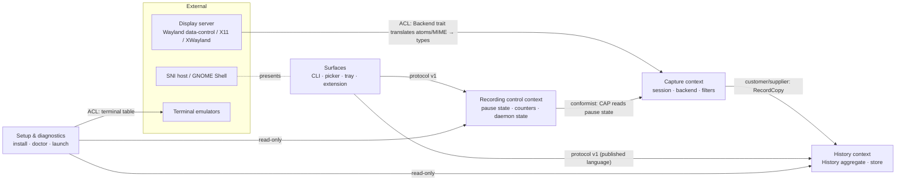

# rstory — domain model

Status: Draft
Last updated: 2026-10-21
Owner stage: `backend:domain`

## 1. Summary

rstory's domain is small and rule-heavy. Its center is the **History**
aggregate, the only place entries are created, reordered, pinned and
deleted. Every cap, de-duplication, expiry and pin rule is an invariant
of that one aggregate, enforced in the pure `domain` module and persisted
by the `store` (ADR-0003). **Capture** turns display-server signals into
copy decisions through the privacy filters, before any content enters the
History. **Recording control** owns the pause state. Restore is a command
on the History (it moves the entry to the top) plus a side effect on the
clipboard owned by the backend. There is one process, one writer and no
distributed consistency. Every context is a module of the single crate
(ADR-0001).

## 2. Inputs used

- Used: `docs/product/brief.md` (glossary, BR1–BR17, journeys K1–K9),
  `docs/product/architecture.md` + ADR-0001…0009, `specs/001…013`
  (`spec.md`, `data-model.md`, clarifications dated 2026-10-21),
  `contracts/protocol.md`.
- Missing: `docs/product/ux-vision.md` (no web UX; the terminal and menu
  surfaces are specified in `tui.md` by `frontend:spec`). There is no
  existing code.

## 3. Event storming

Actors: **User** (through the CLI, picker, tray or panel icon), **Copying
application** (external, through the display server), **Clock**,
**Daemon start/stop** (system).

| # | Journey | Actor | Command | Domain event(s) | Policy | Read model |
|---|---|---|---|---|---|---|
| 1 | K2 Recall | Copying app | (external) clipboard changes | `ClipboardChanged{types, self_owned}` | **Filter policy**: paused › sensitive › no text › oversize › empty → `CopySkipped{reason}`, else `RecordCopy` | — |
| 2 | K2 | Filter policy | `RecordCopy(content)` | `EntryRecorded` or `EntryRefreshed` (duplicate), plus `EntryEvicted`* (count cap) | **Notify policy**: every history event → `history_changed` to subscribers | History list |
| 3 | K2 | User | `RestoreEntry(ref)` | `EntryRestored` (moved to top) | **Ownership policy**: serve the content through the backend, and acknowledge after `OwnershipConfirmed` | — |
| 4 | K2 | Backend | (external) own change observed | `ClipboardChanged{self_owned:true}` | **Self-owned policy**: never record. The entry was already moved to the top by the restore. | — |
| 5 | K3 Sensitive | Copying app | (external) change with hint | `CopySkipped{sensitive}` | Filter policy (decided from types only) | `status.counters` |
| 6 | K3b Timed pause | User | `PauseRecording(for?)` | `RecordingPaused{until?}` | **Resume policy**: when `until` passes → `ResumeRecording` | `status`, tray, panel |
| 7 | K7 | User | `ResumeRecording` | `RecordingResumed` | — | same |
| 8 | J4 Pin | User | `PinEntry(ref)` / `UnpinEntry(ref)` | `EntryPinned` / `EntryUnpinned` | — | History list |
| 9 | K6 / picker | User | `RemoveEntry(ref)` | `EntryRemoved` | — | History list |
| 10 | K7 Clear | User | `ClearHistory{all}` | `HistoryCleared{removed, all}` | — | History list |
| 11 | Expiry | Clock | `ExpireEntries(now)` | `EntryExpired`* | **Housekeeping policy**: arm one timer at `next_expiry` | — |
| 12 | K1/K4 Start | System | `StartDaemon` | `CaptureActivated{backend, mode}` or `CaptureInactive{reason}` | **Reconnect policy**: on `Disconnected` (XWayland), back off and reselect | `status`, doctor |
| 13 | K5 Switch session | System | `StartDaemon` (other session) | `CaptureActivated{x11, native}` | Same store and pause state | — |
| 14 | K7/K8 Open picker | User (menu) | `OpenPicker` | `PickerLaunched{source}` or failure | **Launch policy**: config › `$TERMINAL` › xdg-terminal-exec › list | `status.picker_available` |
| 15 | K8 GNOME setup, K1 autostart | User | `InstallExtension`, `InstallAutostart` | (setup, no domain events) | — | doctor |
| 16 | K9 Release | Maintainer | (outside the runtime domain) | — | — | — |

## 4. Context map



- **Capture → History** (customer/supplier): Capture asks for
  `RecordCopy`, and History decides de-dup, caps and order.
- **Display server → Capture** (anti-corruption layer): the `Backend`
  trait (`specs/002…/contracts/backend.md`) turns X11 atoms and Wayland
  offers into plain type names and byte streams. No display-server type
  crosses it.
- **Surfaces → History / Control** (published language): only protocol v1
  (Constitution IV). The tray is in-process, but it calls the same command
  handlers.
- Mapping onto architecture §5.3: Capture = `session` + `backend` +
  `domain::filter`. History = `domain::history` + `store`. Control =
  `daemon` (state, timers, counters). Surfaces = `cli`, `picker`, `tray`,
  `extension/`. Setup = `install`, `doctor`, `launch`. No upstream gap:
  the contexts fit the single-crate module layout.

## 5. History context

### 5.1 Aggregate: History (root) → Entry (member)

- **Identity:** the History is a singleton per user store. An Entry has an
  `EntryId` (a ULID-like 26-char value, time-ordered, exposed to clients;
  enumeration doesn't matter because the socket is uid-restricted).
- **Commands:** `RecordCopy(content, now)`, `RestoreEntry(ref, now)`
  (reorders only), `PinEntry(ref)`, `UnpinEntry(ref)`, `RemoveEntry(ref)`,
  `ClearHistory{all}`, `ExpireEntries(now)`.
- **Events:** `EntryRecorded{id}`, `EntryRefreshed{id}`,
  `EntryEvicted{id}`, `EntryRestored{id}`, `EntryPinned{id}`,
  `EntryUnpinned{id}`, `EntryRemoved{id}`, `HistoryCleared{removed, all}`,
  `EntryExpired{id}`. Events carry ids only, never content.

**Invariants**

| # | Invariant | Enforced in | Test idea |
|---|---|---|---|
| H1 | The history **must never** hold more than `max_entries` entries (default 20), pinned included. | `History::record` evicts the oldest unpinned after insert | proptest: len ≤ cap after any sequence |
| H2 | The count cap **must never** evict a pinned entry. | eviction picks the oldest unpinned only | proptest with 10 pins + 30 inserts |
| H3 | Pinned entries **must never** exceed `max_pinned` (default 10), and `max_pinned < max_entries` **must always** hold. | `History::pin` → `PinLimit`; config validation | boundary: 11th pin refused |
| H4 | Two entries **must never** share a content hash. | `record` looks up by hash → refresh | proptest: hashes unique |
| H5 | After `ExpireEntries(now)`, no unpinned entry **must** have `now − last_copied > ttl`. | `History::expire` | fake clock |
| H6 | An entry **must always** satisfy `1 ≤ size ≤ max_entry_bytes`, with non-empty content. | `Content::try_from` | cap ± 1 |
| H7 | The order **must always** be `last_copied` descending, and index 0 is the newest. | single ordering rule | proptest |
| H8 | Removing, clearing, expiring or evicting **must always** delete the content from disk in the same operation. | `store` commit (index first, then unlink, then orphan sweep) | crash tests (SC-001 of 001) |
| H9 | An entry **must never** carry source-application data. | type has no such field | compile-time (no field) plus a review |
| H10 | `RestoreEntry` **must always** move the entry to index 0 and refresh `last_copied`, without creating an entry. | `History::touch` | 004 restore tests |

### 5.2 Value objects

| VO | Rules |
|---|---|
| `EntryId` | 48-bit ms timestamp + 80 random bits, Crockford base32, 26 chars. Immutable. |
| `ShortId` | The shortest unique prefix of `EntryId`, at least 4 chars. Computed per listing, never stored. |
| `EntryRef` | `Index(u32)` or `ShortId(String)`. Resolves to exactly one entry, or `NotFound` / `Ambiguous(candidates)`. |
| `Content` | Non-empty bytes, ≤ `max_entry_bytes`. Never `Debug`/`Display`-printed (it prints `<N bytes>`). |
| `ContentHash` | 32-byte BLAKE3 of `Content`. |
| `Preview` | ≤ 256 chars derived from `Content`, with control characters escaped. It's safe to show, but still never logged (Constitution III). |
| `Instant` | UTC timestamp (RFC 3339 on the wire). A future timestamp (clock skew) is treated as `now` for expiry. |
| `Ttl` | Duration, 1 h–90 d, default 7 d. |
| `Caps` | `{max_entries 2–500, max_pinned 0..max_entries−1, max_entry_bytes 1 KiB–1 MiB, ttl}`. |

### 5.3 Lifecycle: Entry

```
            RecordCopy (new hash)
   (none) ───────────────────────────► RECORDED ◄──────────┐
                                          │  ▲              │ UnpinEntry
       RecordCopy (same hash) / Restore   │  │ (refresh,    │
       ───────────────────────────────────┘  │  move to top)│
                                          │ PinEntry [pins < max_pinned]
                                          ▼                 │
                                        PINNED ─────────────┘
   RECORDED ──Remove | Clear | Clear{all} | Expire | Evict──► DELETED (terminal)
   PINNED   ──Remove | Clear{all}──────────────────────────► DELETED (terminal)
```

Illegal transitions (rejected, with tests): `PINNED → Evict`,
`PINNED → Expire`, `PINNED → Clear{all:false}`, a pin over the cap
(`PinLimit`), any command on `DELETED` (`NotFound`), `UnpinEntry` on
`RECORDED` (a no-op success, idempotent), `PinEntry` on `PINNED` (a no-op
success, idempotent).

## 6. Capture context

- **No aggregate**: it's a stateless pipeline plus the backend
  connection.
- **Domain service `CopyFilter`** (spec 005): a pure function of `(types,
  pause state, caps)` that returns `SkipPaused | SkipSensitive |
  IgnoreNoText | ReadWithLimit(limit)`. After the read: `SkipOversize |
  IgnoreEmpty | RecordCopy(content)`.
- **Value objects:** `OfferedTypes` (a set of strings, exact names),
  `SensitiveHint` (the constant list `["x-kde-passwordManagerHint"]`),
  `BackendSelection {backend, mode, reason}`.
- **Policies:**
  - P-C1: decide pause and sensitivity from the types alone, before any
    read (BR5, Constitution III).
  - P-C2: a self-owned change is never recorded (BR2).
  - P-C3: on `Disconnected`, reselect with backoff (100 ms → 5 s).
    Inactive until then.

### Lifecycle: Capture state (in Control)

```
STARTING ──select ok──► ACTIVE ──Disconnected──► RECONNECTING ──ok──► ACTIVE
STARTING ──select none──► INACTIVE{reason}      RECONNECTING ──gives up? never; stays, reports INACTIVE{reconnecting}
```

Illegal transitions: `INACTIVE → recording a copy` (no backend events
can arrive), and serving a restore while INACTIVE (`inactive` error).

## 7. Recording control context

### Aggregate: RecordingState (singleton, persisted in the index's `state`)

- **Commands:** `PauseRecording{until?}`, `ResumeRecording`,
  `Tick(now)` (the timer for timed pause).
- **Events:** `RecordingPaused{until?}`, `RecordingResumed`.
- **Invariants:**
  - R1: while paused, **no** copy **must** be recorded (enforced by the
    filter reading this state, BR3).
  - R2: a timed pause **must always** end at `until` without a client
    command (one-shot timer, BR4b).
  - R3: the pause state **must** survive a restart. A timed pause whose
    `until` has passed resumes on load (BR4, clarified 2026-10-21).
  - R4: `until` **must** be within 1 s–24 h of the command time.

```
RECORDING ──Pause{}──────► PAUSED(∞) ──Resume──► RECORDING
RECORDING ──Pause{for d}─► PAUSED(t) ──Resume | Tick(now ≥ t)──► RECORDING
PAUSED(*) ──Pause{…}─────► PAUSED(new)       (replaces the end time)
```

Illegal: `Resume` while RECORDING is a no-op success (idempotent);
`Tick` while RECORDING is ignored.

**Counters** (`skipped_sensitive`, `skipped_oversize`, `skipped_paused`,
`dropped_burst`): monotonic since start, not persisted. Read model only.

## 8. Authorization model

The single actor class is **the session user** (the uid that owns the
daemon). The socket directory is `0700` and connections are checked with
`SO_PEERCRED`, so any other uid is rejected before any command.

| Command / query | Session user via CLI | Picker | Tray / panel icon | Clock / system |
|---|---|---|---|---|
| list, show, status | ✅ | ✅ (list/show) | ✅ (list top 10, status) | — |
| RestoreEntry | ✅ | ✅ | ✅ | — |
| Pin / Unpin / Remove | ✅ | ✅ | — | — |
| ClearHistory{all:false} | ✅ (confirm) | — | ✅ (confirm) | — |
| ClearHistory{all:true} | ✅ (confirm) | — | — | — |
| Pause / Resume | ✅ | — | ✅ | — |
| OpenPicker | — (`rstory pick`) | — | ✅ | — |
| ExpireEntries, Tick | — | — | — | ✅ |
| Read-only store access | ✅ ls/show (daemon down) | ✅ | — | — |

Object-level rules: none beyond uid, since every entry belongs to the
user who owns the daemon.

## 9. Read models & access patterns

| Read model | Consumer | Filter / sort | Volume | Latency |
|---|---|---|---|---|
| History list (`EntrySummary[]`) | CLI `ls`, picker, extension | all, newest first; the picker filters client-side (fuzzy) | ≤ 20 (≤ 500) | < 50 ms; picker first frame < 100 ms |
| Top 10 | tray, panel | newest 10 | 10 | < 1 ms (in memory) |
| Entry content | `show`, picker preview, restore | by id | 1 | < 5 ms (one file read) |
| Status | CLI, tray, panel, doctor | — | 1 | < 5 ms |
| Next deadline | daemon timer | `min(next_expiry, paused_until)` | 1 | O(n) at n ≤ 500 |

Indexes: the in-memory `Vec` ordered by `last_copied` plus a
`HashMap<ContentHash, EntryId>`. On disk, the whole index is in one file.

## 10. Consistency & concurrency

- **Strong consistency** inside the single writer. Every command is
  applied sequentially on the daemon's event loop. There are no
  concurrent writers (exclusive `flock`, single instance).
- **Contention points:** (1) a copy burst competes with user commands, so
  the bounded queue and batching mean user commands are served between
  batches. (2) A restore races an external copy: the last ownership wins,
  and the History records the external copy normally.
- **Readers while the daemon is down:** a shared lock gives a consistent
  snapshot, because index replacement is an atomic rename.
- **Idempotency:** pin, unpin and resume are idempotent. Remove of a
  missing ref returns `not_found`, which is safe to retry. Restore is
  naturally idempotent (same content, top position).
- **Optimistic locking:** not needed (one writer, no remote clients).

## 11. Data ownership, privacy & retention

| Data | Owner context | Classification | Retention / deletion | Audit |
|---|---|---|---|---|
| Entry content | History | **may contain personal or sensitive data of anyone** (whatever the user copies), so it's treated as sensitive | 7 days unpinned (configurable 1 h–90 d), count cap 20, real deletion (H8). Pinned entries stay until unpinned or removed. | none (no logs of content). Counters only. |
| Preview | History | same as content (derived) | same as its entry | — |
| Entry metadata (id, hash, size, timestamps, pinned) | History | not personal by itself | same as its entry | — |
| Pause state | Control | none | until changed | — |
| Counters | Control | none | process lifetime | — |
| Config | Setup | none | user-managed | — |

Personal data never leaves the machine (BR17), is never logged (BR12),
and source applications are never recorded (BR11). Hinted content is
never read (P-C1).

## 12. Integrations

| System | Direction | Sync/async | ACL translation | Idempotency | Failure behavior |
|---|---|---|---|---|---|
| Wayland data-control | both | async (fd events) | `Backend` trait: offers → `OfferedTypes`, pipe → bytes | serve is idempotent per content | `Disconnected` → daemon exits (session over) |
| X11 / XWayland | both | async | atoms → type names, INCR handled inside | same | `Disconnected` → reconnect with backoff (bridge) or exit (X11 session) |
| SNI host (D-Bus) | daemon → host | async | menu model → DBusMenu layout | layout revisions | `no_host` / `no_bus` in status. Everything else works. |
| GNOME Shell extension | extension → daemon | async (socket) | protocol v1 | request ids | reconnect 1 → 30 s. A "disconnected" icon. |
| Terminal emulators | daemon → spawn | fire-and-forget | terminal table → argv | — | `no_terminal` / `picker_command_failed` errors. The menu item is hidden. |

## 13. Volumes

| Aggregate / path | Count or rate | Source |
|---|---|---|
| History entries | ≤ 20 default (≤ 500 configured) | brief §11 |
| Pinned entries | ≤ 10 default | decision 2026-10-21 |
| `RecordCopy` | ~500/day average, bursts of 50/s (10×: 500/s) | architecture §4 |
| User commands | ~120/day | architecture §4 |
| Content per entry | typically < 4 KiB, max 1 MiB | brief §11 |
| Expiry timer firings | ≤ 1 per expiring entry (~ copies/day) | derived |

## 14. Review against backend-quality modeling tells

- **CRUD everywhere:** avoided. The protocol exposes verbs (`restore`,
  `pin`, `pause`, `clear`), and there's no generic update of an entry.
- **Anemic model:** avoided. Invariants H1–H10 live on `History`, and
  R1–R4 on `RecordingState`, both pure and unit-testable. The store only
  persists.
- **Noun per service:** avoided. One crate, contexts as modules
  (ADR-0001).
- **Free-string status:** avoided. `DaemonState`, `PauseState`,
  `BackendSelection.mode` and the filter decisions are enums with listed
  transitions.
- **Revision made:** pin, unpin and resume were made idempotent no-ops
  instead of errors, so menu double-clicks and script retries are safe.
  Restore was modeled as a History command (H10), not only a backend side
  effect, so ordering stays an aggregate invariant.

## 15. Open questions

- None that block `backend:spec`. Still open from upstream: brief Q7
  (bridge behavior on GNOME 49–51, a release check) and the remaining S2
  hint tests (a spec 005 amendment if new hints are found).

## 16. Decision log

| Date | Decision | Alternatives | Reason |
|---|---|---|---|
| 2026-10-21 | One History aggregate holds all entry rules. Entries are members, not aggregates. | Entry as its own aggregate | The caps and de-dup are cross-entry invariants. They need one consistency boundary. |
| 2026-10-21 | RecordingState is a separate singleton aggregate, persisted with the index. | A field on History | A different lifecycle and commands. It shares a file only for atomicity of startup state. |
| 2026-10-21 | Pin, unpin and resume are idempotent. | Error on a no-op | Safe retries from menus and scripts. |
| 2026-10-21 | Domain events carry ids only. | Events with previews | Constitution III: no content outside `show`. |
